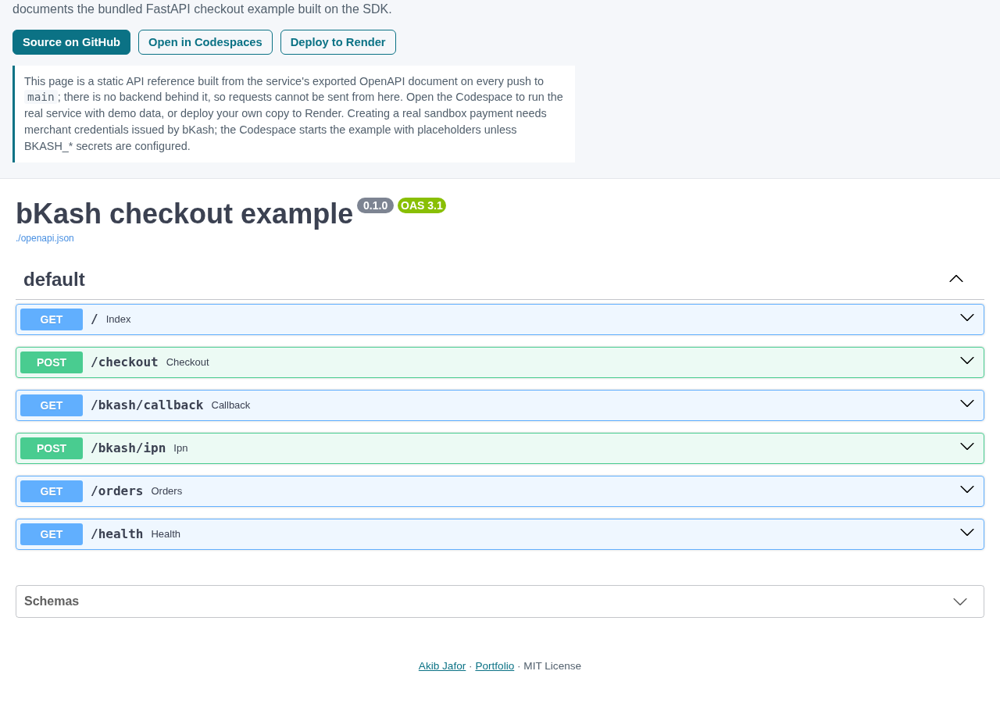
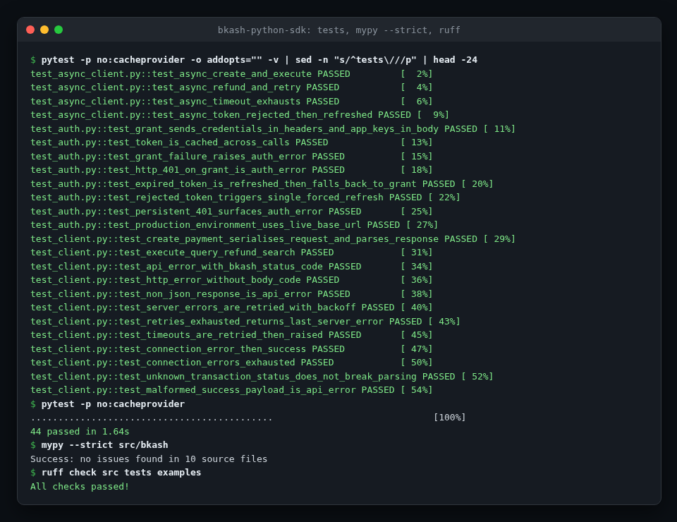
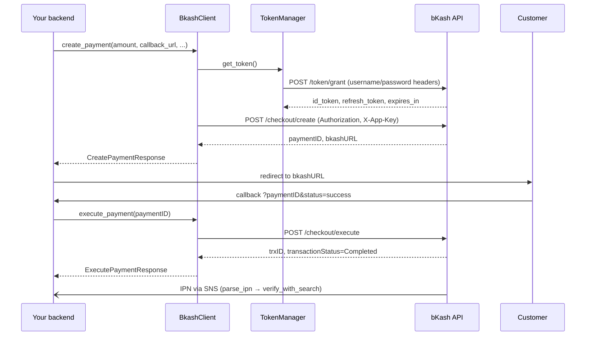

<!-- topics: bkash,python,sdk,payment,httpx,pydantic,async,bangladesh,fintech -->
# bkash-python-sdk

A typed Python client for the bKash Tokenized Checkout API with sync and async clients, automatic token refresh, retries with backoff, Pydantic models for every request and response, and helpers for IPN notifications.

[](https://github.com/AkibUllah/bkash-python-sdk/actions/workflows/ci.yml)
[](https://github.com/AkibUllah/bkash-python-sdk/actions/workflows/codeql.yml)
[](https://github.com/AkibUllah/bkash-python-sdk/releases)


## Try it live

| | |
|---|---|
| API reference | https://akibullah.github.io/bkash-python-sdk/ — Swagger UI of the bundled FastAPI checkout example, built from its exported OpenAPI document (static; no backend behind it) |
| Run in your browser | [](https://codespaces.new/AkibUllah/bkash-python-sdk?quickstart=1) — installs the SDK and starts the checkout example on forwarded port 8000 (`/` demo form, `/docs`). Add `BKASH_APP_KEY`, `BKASH_APP_SECRET`, `BKASH_USERNAME` and `BKASH_PASSWORD` as Codespaces secrets to make real sandbox payments; without them the sandbox rejects `POST /checkout`. |
| One-click deploy | [](https://render.com/deploy?repo=https://github.com/AkibUllah/bkash-python-sdk) — `render.yaml` deploys the example and prompts for the four sandbox credentials; callback and IPN URLs follow the Render hostname. |
| Local | `docker compose up` (see Quick Start) |

## Screenshots



Live API reference on GitHub Pages for the bundled FastAPI checkout example.



A real local run of the test suite (token caching and refresh, retries, error mapping, IPN helpers), `mypy --strict` and ruff.

## Why this exists

bKash is the mobile wallet most Bangladeshi customers reach for, and integrating it has meant copying the same 300 lines between projects: grant a token, remember when it expires, add the two auth headers, map `statusCode != "0000"` to an exception, retry the occasional 5xx, and work out what the SNS-wrapped IPN body actually contains. I wrote this package so that logic lives in one tested place with proper types, so a checkout flow reads as `create → redirect → execute → fulfil` instead of HTTP plumbing. It targets the Tokenized Checkout API (`v1.2.0-beta`) sandbox and production hosts and never touches the network in its test suite.

## Features

- `BkashClient` (sync) and `AsyncBkashClient` (asyncio) with identical method surfaces, both usable as context managers
- Token grant with caching, early refresh (configurable margin), refresh-token use and automatic fallback to a new grant; a rejected token on any call triggers exactly one forced refresh and retry
- `create_payment`, `execute_payment`, `query_payment`, `refund`, `search_transaction`
- Pydantic v2 models that accept bKash's wire names (`paymentID`, `trxID`, `bkashURL`) and expose snake_case attributes; unknown fields are preserved, unknown statuses map to `TransactionStatus.UNKNOWN` rather than failing
- Amounts are `Decimal`, validated to two places and serialised as the `"1500.00"` strings bKash expects
- Typed exceptions: `BkashAuthError`, `BkashAPIError` (with `status_code`, `error_code`, `description`, raw `response`), `BkashTimeoutError`, `BkashNetworkError`, `BkashWebhookError`
- Retry with exponential backoff and full jitter on 5xx, timeouts and connection errors; schedule and attempt count configurable per client, sleep injectable
- IPN helpers: parse SNS `Notification`/`SubscriptionConfirmation` envelopes or bare JSON, local amount/invoice matching, and verification against `search_transaction`
- Configurable timeouts, custom `httpx` client injection (proxies, transports, mocking), `BkashConfig.from_env()`
- Ships `py.typed`, passes `mypy --strict`

## Architecture



Design notes:

- **Transport-agnostic core.** Header building, error classification and model parsing live in `bkash._core` and are shared by both clients, so sync and async cannot drift apart.
- **Tokens are a lock-protected state machine.** `TokenManager` (threading lock) and `AsyncTokenManager` (asyncio lock) share the same grant/refresh/fallback logic; only the awaiting differs.
- **Errors are data.** bKash reports most failures as HTTP 200 with a non-`0000` `statusCode`; `raise_for_error` normalises those and real HTTP errors into one exception hierarchy with the raw body attached.
- **Retries never hide a decline.** Only 5xx, timeouts and connection failures are retried; a 4xx or a business `statusCode` is raised immediately.
- **IPN is advisory.** The SNS payload is not signed by bKash, so the helpers make it easy to confirm with `search_transaction` before fulfilling.

## Tech Stack

| Component | Choice |
| --- | --- |
| HTTP | httpx (sync + async), injectable client/transport |
| Models | Pydantic v2 with aliases, `Decimal` money |
| Packaging | hatchling, PEP 621, `src/` layout, `py.typed` |
| Quality | pytest + pytest-asyncio + respx, ruff, mypy `--strict` |
| CI | GitHub Actions matrix (3.10 / 3.11 / 3.12), wheel build check |

## Quick Start

### Install

```bash
pip install bkash-checkout            # package name on PyPI; import name is `bkash`
# or from source
git clone https://github.com/AkibUllah/bkash-python-sdk.git && cd bkash-python-sdk
make install
```

### Run the FastAPI checkout example (Docker or local)

```bash
cp .env.example .env                   # fill in your sandbox credentials from bKash
docker compose up --build              # http://localhost:8000/checkout
# or
make example                           # uvicorn on :8000 using .venv
```

## Usage

### Sync

```python
from bkash import BkashClient, BkashConfig, BkashAPIError

config = BkashConfig.sandbox(app_key, app_secret, username, password)

with BkashClient(config) as client:
    created = client.create_payment(
        amount="1500.00",
        payer_reference="01711000000",
        callback_url="https://shop.example/bkash/callback",
        merchant_invoice_number="INV-2026-0001",
    )
    redirect_url = created.bkash_url          # send the customer here

    # ... customer returns to callback_url?paymentID=...&status=success
    try:
        executed = client.execute_payment(created.payment_id)
    except BkashAPIError as exc:
        if exc.error_code == "2062":          # already completed: confirm instead
            executed = client.query_payment(created.payment_id)
        else:
            raise

    if executed.is_completed:
        fulfil_order(trx_id=executed.trx_id, amount=executed.amount)
```

### Async

```python
from bkash import AsyncBkashClient, BkashConfig

async with AsyncBkashClient(BkashConfig.from_env()) as client:
    created = await client.create_payment(amount="250", payer_reference="01711000000",
                                          callback_url=CALLBACK, merchant_invoice_number="INV-7")
    status = await client.query_payment(created.payment_id)
```

### Refunds and lookups

```python
refund = client.refund(
    payment_id=executed.payment_id, trx_id=executed.trx_id,
    amount="500.00", sku="SKU-42", reason="one item returned",
)
print(refund.refund_trx_id, refund.amount, refund.charge)

txn = client.search_transaction("9HK7A2B3C4")
print(txn.transaction_status, txn.customer_msisdn)
```

### Retries, timeouts and custom HTTP clients

```python
from bkash import BkashConfig, RetryPolicy
import httpx

config = BkashConfig.sandbox(
    app_key, app_secret, username, password,
    timeout=15.0, connect_timeout=5.0,
    retry=RetryPolicy(max_attempts=5, base_delay=0.5, max_delay=8.0),   # or RetryPolicy.none()
)
client = BkashClient(config, http_client=httpx.Client(base_url=config.resolved_base_url,
                                                      proxy="http://proxy.internal:3128"))
```

### IPN endpoint

```python
from bkash import parse_ipn, IPNSubscriptionConfirmation, BkashWebhookError
from bkash.webhooks import verify_with_search

@app.post("/bkash/ipn")
async def ipn(request: Request):
    try:
        message = parse_ipn(await request.body())
    except BkashWebhookError:
        return Response(status_code=400)
    if isinstance(message, IPNSubscriptionConfirmation):
        httpx.get(message.subscribe_url)          # one-time activation
        return {"ok": True}
    txn = await client.search_transaction(message.trx_id)
    if verify_with_search(message, txn):
        mark_paid(message.merchant_invoice_number, message.trx_id)
    return {"ok": True}
```

### Exceptions

| Exception | When |
| --- | --- |
| `BkashAuthError` | token grant/refresh rejected, HTTP 401/403, or `statusCode` 2001 |
| `BkashAPIError` | any other non-`0000` `statusCode` or non-2xx response; see `.error_code`, `.description`, `.response` |
| `BkashTimeoutError` | request timed out on every attempt |
| `BkashNetworkError` | connection failed on every attempt |
| `BkashWebhookError` | IPN body could not be parsed |

## Project Structure

```
src/bkash/
├── __init__.py        # public API
├── client.py          # BkashClient (sync)
├── async_client.py    # AsyncBkashClient
├── auth.py            # TokenManager / AsyncTokenManager
├── _core.py           # paths, headers, error mapping, model parsing
├── config.py          # BkashConfig, Environment
├── models.py          # request/response models
├── retry.py           # RetryPolicy
├── webhooks.py        # parse_ipn, verify_with_search, verify_hmac_signature
├── exceptions.py
└── py.typed
examples/fastapi_checkout/  # end-to-end checkout app
tests/                      # respx-mocked, no network
```

## Testing

```bash
make test        # pytest (respx mocks every bKash endpoint)
make lint        # ruff + mypy --strict
```

Covered: grant request shape, token caching, refresh near expiry, fallback to grant when refresh is rejected, forced refresh on a rejected token, auth error classification; request serialisation and response parsing for all five operations; `statusCode` and HTTP error mapping, non-JSON bodies, malformed success payloads, unknown statuses; retry schedule, exhaustion and timeout/connection behaviour for both clients; model validation of amounts and wire aliases; config validation and `from_env`; IPN parsing of SNS envelopes, bare JSON and subscription confirmations, invalid payloads, local matching and search verification.

## Roadmap

- [ ] Agreement (tokenized "0001"/"0000" mode) create/execute/cancel endpoints (#1)
- [ ] Recorded sandbox cassettes for contract tests against real responses (#2)
- [ ] Optional `requests`-free Django integration helpers (view mixins for callback/IPN) (#3)
- [ ] Structured logging hooks for request/response tracing with secret redaction (#4)

## License

MIT — see [LICENSE](LICENSE).
